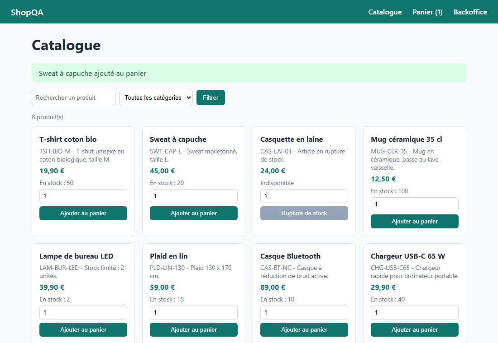
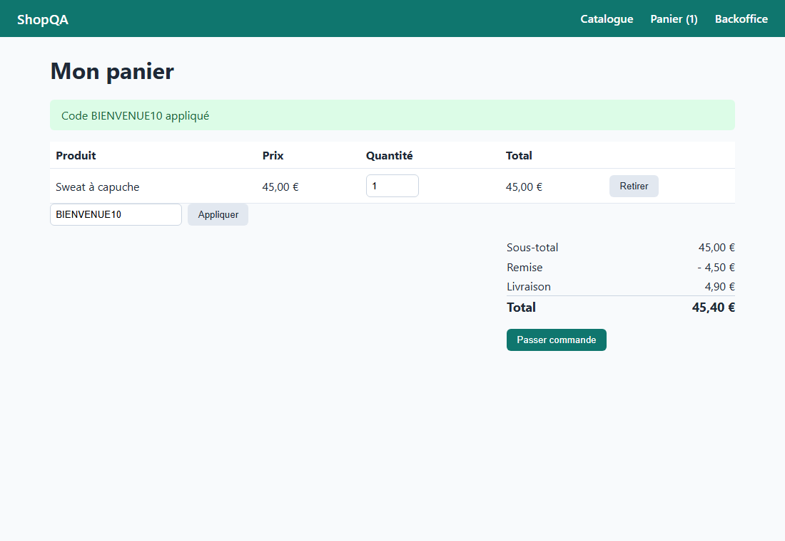

# Uimad QA : stratégie et automatisation des tests d'une boutique e-commerce

[](https://github.com/eimade/qa-ecommerce-test-suite/actions/workflows/ci.yml)

Projet de démonstration **QA** : une démarche de test complète (stratégie, plan, traçabilité, jeux de données, anomalies, reporting) et son automatisation (Postman/Newman, Playwright, test de charge), appliquées à une mini-boutique volontairement simple.

## Problématique

Une équipe e-commerce en Agile/SAFe livre à chaque itération des évolutions du catalogue, du panier, du paiement et du backoffice. Elle doit **sécuriser chaque livraison** : savoir ce qui est couvert, rejouer la régression en quelques minutes, tracer chaque exigence jusqu'à son résultat d'exécution et décider **GO / NO GO** sur des métriques claires.

Ici, la boutique n'est que le support : l'essentiel du travail se trouve dans `docs/`, `tests/` et `xray/`.

## Livrables QA (`docs/`)

| Livrable | Fichier |
|---|---|
| Stratégie de tests (pyramide, techniques, critères d'entrée et de sortie, risques) | [docs/01-strategie-de-tests.md](docs/01-strategie-de-tests.md) |
| Plan de tests de la campagne de régression | [docs/02-plan-de-tests.md](docs/02-plan-de-tests.md) |
| Matrice de traçabilité exigences <-> cas (générée) | [docs/03-matrice-tracabilite.md](docs/03-matrice-tracabilite.md) |
| Jeux de données (catalogue, clients, cartes, promos, valeurs limites) | [docs/04-jeux-de-donnees.md](docs/04-jeux-de-donnees.md) |
| Definition of Done et rituels SAFe, métriques | [docs/05-definition-of-done-safe.md](docs/05-definition-of-done-safe.md) |
| Gabarit d'anomalie et échelle de sévérité (avec les deux anomalies réelles de la campagne) | [docs/06-gabarit-anomalie.md](docs/06-gabarit-anomalie.md) |
| Rapport de campagne avec métriques (instantané généré) | [docs/07-rapport-campagne.md](docs/07-rapport-campagne.md) |
| Correspondance avec les modules SAP Commerce (Hybris) | [docs/08-correspondance-sap-commerce.md](docs/08-correspondance-sap-commerce.md) |

## Fonctionnalités

- **Boutique à tester** (`shop-demo/`) : API REST Express + 4 pages (catalogue, panier, commande, backoffice). Catalogue filtrable, panier avec contrôle de stock et codes promo, livraison offerte dès 50 EUR, paiement simulé, cycle de vie des commandes.
- **15 exigences, 27 cas de test** (25 automatisés, 2 manuels) dans une source unique : `xray/referentiel-tests.json`.
- **Tests API** : collection Postman de 31 requêtes et 97 assertions, exécutée par Newman (rapport HTML htmlextra, JUnit, JSON).
- **Tests E2E** Playwright : parcours d'achat et régression (9 scénarios, tags `@smoke` et `@regression`, Page Object, données réinitialisées avant chaque test).
- **Performance** : charge légère du catalogue avec autocannon et seuils bloquants (p99, débit, erreurs).
- **Xray (simulé)** : import des cas (JSON et CSV) et conversion des résultats Newman, Playwright et autocannon au format d'import d'exécution Xray.
- **Reporting** : rapport de campagne généré (taux de réussite, couverture des exigences, défauts par sévérité, verdict GO / NO GO).
- **CI** : GitHub Actions et `azure-pipelines.yml` équivalent ; leur équivalence est vérifiée automatiquement.

## Architecture

```
qa-ecommerce-test-suite/
├── shop-demo/                     Système testé
│   ├── src/domain/                  règles métier : pricing, validation, paiement (bouchon), service
│   ├── src/http/app.ts              couche HTTP Express, erreurs JSON { error: { code, message } }
│   ├── public/                      pages HTML + JS (sélecteurs data-testid)
│   └── test/                        Vitest : unitaires + intégration API (Supertest)
├── tests/
│   ├── api/                       Collection + environnement Postman (Newman)
│   ├── e2e/                       Playwright : fixtures (Page Object, reset), parcours, régression
│   └── perf/                      autocannon : SHOP-301
├── xray/
│   ├── referentiel-tests.json     SOURCE UNIQUE : exigences + cas de test
│   ├── anomalies.json             registre des anomalies
│   ├── import/                    tests-xray.json / tests-xray.csv (générés)
│   └── scripts/                   génération des imports, conversion des résultats
├── tools/                         rapport de campagne, métriques, validation des pipelines
├── docs/                          livrables QA
├── .github/workflows/ci.yml       CI GitHub Actions
├── azure-pipelines.yml            pipeline Azure DevOps équivalent
└── docker-compose.yml             boutique (port 13100) + Newman conteneurisé (profil qa)
```

Flux de la campagne :

```
referentiel-tests.json ──> matrice + import Xray (JSON/CSV)     [npm run xray:cases]
          │
          ▼
 Vitest ─> Newman ─> Playwright ─> autocannon                    [CI ou poste local]
            │           │              │
            ▼           ▼              ▼
     newman.json   results.json    perf.json  ──> execution-xray.json  [npm run xray:results]
                                                └─> rapport-campagne.md [npm run report]
```

## Stack

TypeScript, Node.js 22, Express 5, Vitest, Supertest, Postman / Newman (+ newman-reporter-htmlextra), Playwright, autocannon, Docker Compose, GitHub Actions, Azure DevOps Pipelines (YAML), format d'import Xray (JSON/CSV).

## Lancement

Prérequis : Docker, ou Node.js 22.

```bash
# Boutique dans Docker (http://localhost:13100), en 1 commande
docker compose up -d --build

# Campagne API dans un conteneur Newman
docker compose --profile qa run --rm newman

# Arrêt
docker compose --profile qa down
```

Campagne complète depuis le poste (la boutique doit tourner sur le port 13100, ou Playwright la démarre lui-même) :

```bash
npm ci && npx playwright install chromium
npm run test:unit        # Vitest : 39 tests unitaires et d'intégration
npm run test:api         # Newman -> reports/newman/rapport-newman.html
npm run test:e2e         # Playwright -> reports/playwright/html
npm run test:perf        # autocannon -> reports/perf/perf.json
npm run xray:results     # -> reports/xray/execution-xray.json
npm run report           # -> reports/rapport-campagne.md
```

Autres commandes : `npm run test:e2e:smoke`, `npm run xray:cases` (régénère matrice et imports, contrôle la cohérence), `npm run validate:pipelines`.

## Captures

| Catalogue | Panier avec code promo |
|---|---|
|  |  |

## Exemples d'appels API

```bash
curl -s "http://localhost:13100/api/products?category=high-tech"
# [{"id":"p-007","sku":"CAS-BT-NC","name":"Casque Bluetooth","category":"high-tech","priceCents":8900,"stock":10,...}, ...]

CART=$(curl -s -X POST http://localhost:13100/api/carts | node -pe "JSON.parse(require('fs').readFileSync(0)).id")
curl -s -X POST "http://localhost:13100/api/carts/$CART/items" -H "Content-Type: application/json" \
     -d '{"productId":"p-005","quantity":3}'
# 409 {"error":{"code":"OUT_OF_STOCK","message":"Stock insuffisant pour Lampe de bureau LED (disponible : 2)","details":{"productId":"p-005","available":2}}}

curl -s -X POST "http://localhost:13100/api/carts/$CART/items" -H "Content-Type: application/json" \
     -d '{"productId":"p-005","quantity":1}'

curl -s -X POST http://localhost:13100/api/orders -H "Content-Type: application/json" -d "{\"cartId\":\"$CART\",
  \"customer\":{\"name\":\"Client Recette\",\"email\":\"client.recette@example.com\",\"address\":\"12 rue de la Recette\",\"postalCode\":\"75011\",\"city\":\"Paris\"},
  \"payment\":{\"cardNumber\":\"4000000000000002\"}}"
# 402 {"error":{"code":"PAYMENT_DECLINED","message":"Paiement refusé : fonds insuffisants"}}

curl -s http://localhost:13100/api/admin/orders -H "x-admin-token: demo-admin-token-local"
```

| Méthode | Route | Rôle |
|---|---|---|
| GET | `/api/products?category=&q=` | Catalogue filtré |
| GET | `/api/products/:id` | Fiche produit |
| POST | `/api/carts` | Créer un panier |
| GET | `/api/carts/:id` | Panier et totaux |
| POST / PATCH / DELETE | `/api/carts/:id/items[/:productId]` | Ajouter, modifier, retirer |
| POST | `/api/carts/:id/promo` | Appliquer un code promo |
| POST | `/api/orders` | Commander et payer |
| GET | `/api/orders/:id` | Consulter une commande |
| GET / PATCH | `/api/admin/orders[/:id]` | Backoffice (en-tête `x-admin-token`) |
| POST | `/api/test/reset` | Remise à zéro des données (recette uniquement) |

## Simulations

Les outils payants ou nécessitant un compte sont remplacés par des bouchons documentés. Ils démontrent la compréhension du besoin, pas une intégration réelle.

| Élément réel | Ce qui est fait ici | Où | Pour passer au réel |
|---|---|---|---|
| **JIRA / Xray** (pas de compte) | Les cas sont maintenus dans `xray/referentiel-tests.json`. `npm run xray:cases` produit `xray/import/tests-xray.json` (import en masse JSON, type Manual, étapes action / données / résultat, `update_key` sur des tickets supposés existants) et `tests-xray.csv` (Test Case Importer, une ligne par étape). `npm run xray:results` convertit les rapports Newman, Playwright et autocannon en **JSON d'exécution Xray** (`info` + `tests[]` avec `testKey`, `status` PASSED / FAILED / TODO, dates, commentaires d'échec). Les clés SHOP-xxx sont portées par le nom des requêtes Postman et le titre des tests Playwright. | `xray/` | Envoyer le fichier : `curl -H "Authorization: Bearer $XRAY_TOKEN" -H "Content-Type: application/json" --data @reports/xray/execution-xray.json https://xray.cloud.getxray.app/api/v2/import/execution`. Le format a été écrit d'après la documentation Xray, sans validation sur une instance réelle. |
| **Azure DevOps** (pas d'organisation) | `azure-pipelines.yml` reproduit les 3 jobs GitHub en 3 stages (Qualite, Campagne, Docker). Il ajoute `PublishTestResults@2` (les JUnit de Vitest, Newman et Playwright alimentent l'onglet Tests du run) et `PublishPipelineArtifact@1` (rapports HTML). `npm run validate:pipelines` vérifie la syntaxe YAML, la structure (stages, jobs, tâches `Nom@version`, dépendances) et l'**équivalence** : mêmes scripts npm et commandes Docker des deux côtés. | `azure-pipelines.yml`, `tools/valider-pipelines.js` | Créer un pipeline sur ce fichier ; aucune adaptation de code prévue. Non exécuté, faute d'organisation. |
| **SAP Commerce (Hybris)** (progiciel sous licence) | La boutique reprend le découpage catalogue / panier / checkout / backoffice. Une note fait correspondre chaque cas aux modules SAP Commerce (Product Catalog, Solr, Promotion Engine, Checkout, OMS, Backoffice) et liste les adaptations (OCC API, ImpEx). | `docs/08-correspondance-sap-commerce.md` | Pointer la collection Postman sur l'OCC REST API, charger les données par ImpEx. |
| **Prestataire de paiement** | `SimulatedPaymentGateway` derrière l'interface `PaymentGateway` : la carte 4000 0000 0000 0002 est refusée, toute autre carte valide (Luhn) est acceptée. | `shop-demo/src/domain/payment.ts` | Implémenter l'interface avec le SDK du PSP en sandbox. |
| **Base de données** | Stockage en mémoire et jeu de données restauré par `POST /api/test/reset`, route exposée seulement si `ENABLE_TEST_RESET=true`. | `shop-demo/src/domain/shop-service.ts` | Hors sujet pour un projet QA ; un vrai projet aurait une base de recette et un chargement de données (ImpEx, scripts SQL). |

## Choix techniques

- **Source unique pour la traçabilité** : la matrice, les imports Xray et l'export des résultats sont générés depuis un seul fichier. La CI échoue si la matrice commitée n'est pas à jour (`git diff --exit-code`) ou si un cas déclaré automatisé n'existe pas dans le code de test. On ne peut donc pas annoncer une couverture qui n'existe pas.
- **Pyramide** : les valeurs limites de calcul (arrondi de la remise, seuil de 50 EUR évalué après remise) sont testées en unitaire ; Newman couvre le contrat et les règles côté API ; Playwright ne couvre que les parcours.
- **Tests reproductibles** : remise à zéro avant chaque test, `workers: 1` (l'état est partagé en mémoire), sélecteurs `data-testid`, attentes web-first sans `sleep`. En CI, une relance est autorisée et un test qui ne passe qu'à la relance remonte « instable » dans le commentaire Xray.
- **Erreurs au format stable** (`code` constant) : les tests vérifient le code d'erreur et non le libellé, sauf quand le message affiché fait partie de l'exigence.
- **Verdict calculé** (`tools/metrics.js`, testé unitairement) : GO seulement si tous les cas automatisés Critique et Haute réussissent, sans échec et sans anomalie Bloquante ou Majeure ouverte.
- **Ports hôtes peu courants** (13100) pour cohabiter avec d'autres projets. Le jeton administrateur de démonstration n'est pas un secret : il est surchargeable par `ADMIN_TOKEN` (voir `.env.example`).

## Résultats de la dernière campagne

Voir [docs/07-rapport-campagne.md](docs/07-rapport-campagne.md) : 25 cas automatisés sur 25 réussis, 15 exigences sur 15 validées, 2 cas manuels à exécuter, verdict GO. Deux anomalies réelles relevées : ANO-001 (mineure, recherche trop large, ouverte et à arbitrer par le PO) et ANO-002 (majeure, numéro de carte exposé dans l'URL si on clique sur Payer trop tôt, corrigée et couverte par SHOP-207 et SHOP-209).

## Limites connues

- La boutique est un support de test minimaliste : données en mémoire, pas de comptes clients, paiement simulé.
- Les formats Xray (import des cas et des résultats) et le pipeline Azure DevOps n'ont pas été validés sur de vraies instances.
- Le test de performance est une charge légère (25 connexions, 10 s), pas un test de montée en charge. Ses seuils valent pour un agent Linux ou un appel depuis le réseau Docker. Mesuré depuis l'hôte via la redirection de port de Docker Desktop sous Windows, il échoue (p99 d'environ 550 ms) à cause de l'environnement :
  `docker run --rm --network qa-ecommerce-test-suite_default -v "$PWD":/w -w /w -e BASE_URL=http://shop:3000 node:22-alpine node tests/perf/charge-catalogue.js`
- Les cas manuels SHOP-401 (clavier) et SHOP-402 (mobile) sont décrits mais pas exécutés : ils apparaissent en TODO.

## Licence

MIT
